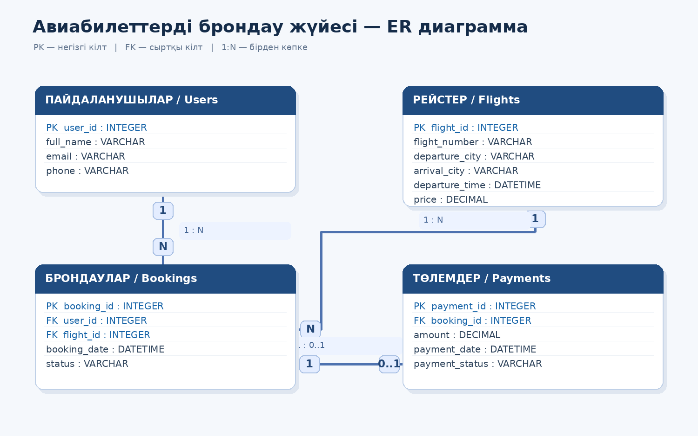

# Airline Ticket Booking System

## Жоба туралы
Бұл жоба авиабилеттерді брондауға арналған ақпараттық жүйе.

## Жобаның мақсаты
Пайдаланушыларға әуе рейстерін іздеу, билет брондау және төлемдерді тіркеу мүмкіндігін беру.

## Негізгі кестелер
1. **Users** — пайдаланушылар туралы ақпарат.
2. **Flights** — әуе рейстері туралы ақпарат.
3. **Bookings** — билеттерді брондау мәліметтері.
4. **Payments** — төлемдер туралы ақпарат.

## Кестелер арасындағы байланыстар
- Users → Bookings (1:N)
- Flights → Bookings (1:N)
- Bookings → Payments (1:0..1)

## ER-диаграмма


## Қолданылатын технологиялар
- Python
- FastAPI, Uvicorn — API
- SQLModel (SQLite) — деректер базасы
- Streamlit — интерфейс
- Git және GitHub
- draw.io (ER-диаграмма)

## Жоба құрылымы
- `main.py` — FastAPI қосымшасының кіру нүктесі
- `app/models/` — SQLModel модельдері (Flight, Passenger, Booking)
- `app/api/` — API эндпоинттері
- `app/database/` — деректер базасына қосылу
- `frontend/` — Streamlit интерфейсі
- `seed.py` — сынақ рейстері мен жолаушыларды қосады

## Іске қосу
```bash
python -m venv venv
venv\Scripts\activate
pip install -r requirements.txt

python seed.py                                   # сынақ деректері
python -m uvicorn main:app --reload              # API: http://127.0.0.1:8000/docs
python -m streamlit run frontend/app.py          # UI: http://localhost:8501
```
API мен Streamlit-ті бөлек терминалдарда іске қосыңыз.

## API
| Эндпоинт | Сипаттама |
|---|---|
| `GET/POST /flights/` | рейстер тізімі / рейс қосу |
| `GET /flights/{id}/availability` | бос орындар саны |
| `GET/POST /passengers/` | жолаушылар тізімі / жолаушы қосу |
| `GET/POST /bookings/` | брондаулар тізімі / брондау жасау |
| `GET /bookings/{id}` | брондауды көру |
| `POST /bookings/{id}/cancel` | брондаудан бас тарту (орын босайды) |

## Жоба кезеңдері
- [x] Тақырып таңдау
- [x] Негізгі кестелерді анықтау
- [x] ER-диаграмма құру
- [x] GitHub репозиторийін ашу
- [x] README.md және .gitignore қосу
- [ ] Python бағдарламасын әзірлеу

## Автор
Nazar Baktykerey — 2026# Airline-Ticket-Booking-System
